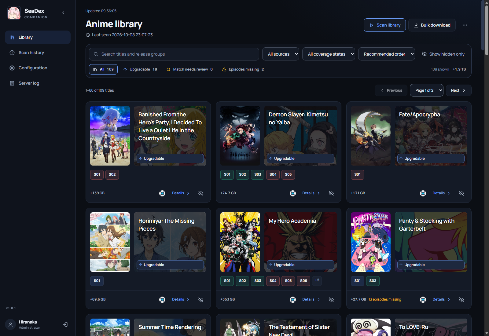
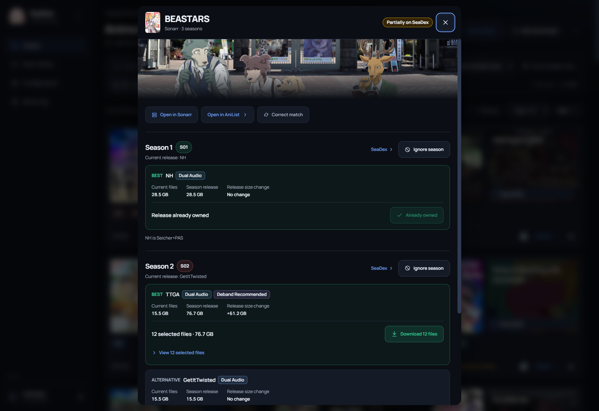
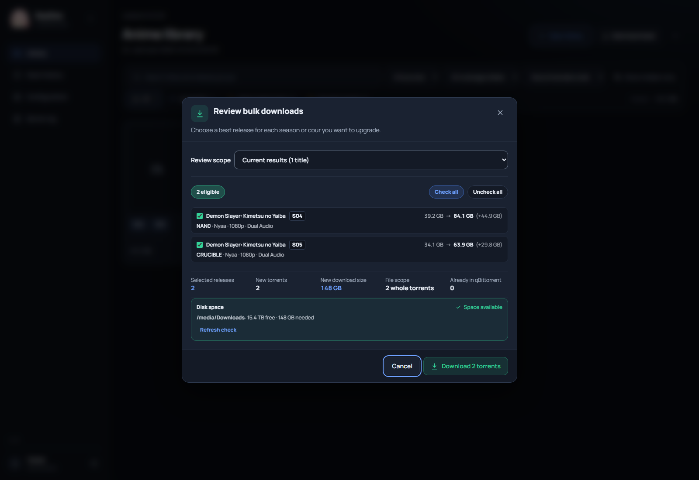
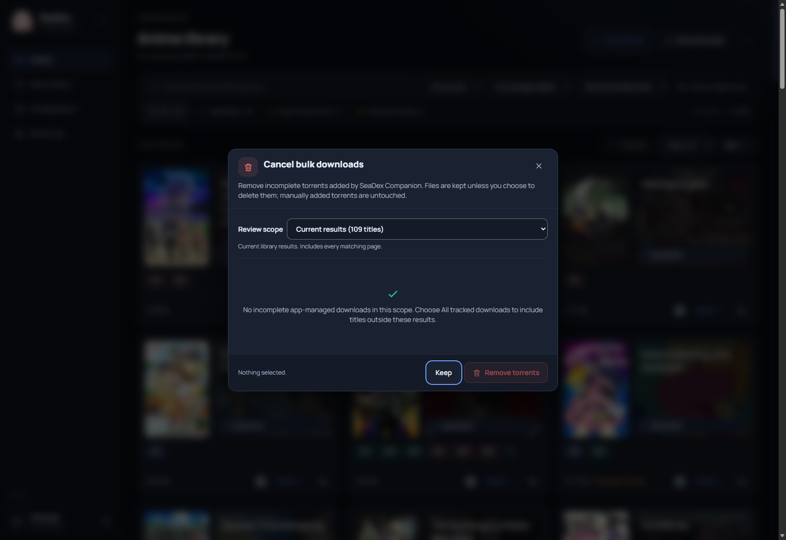
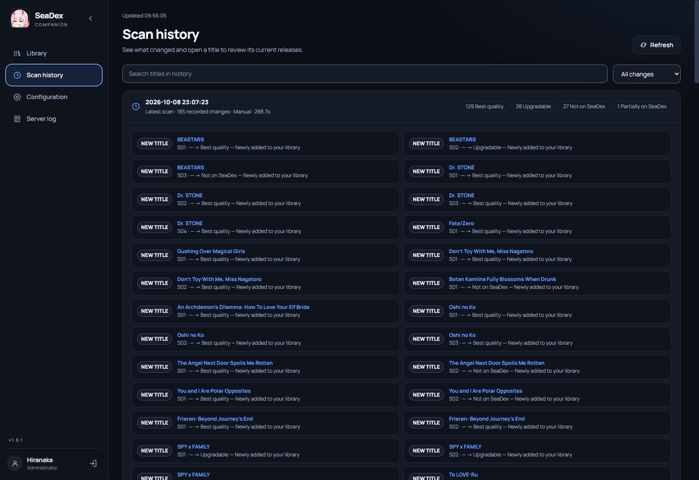
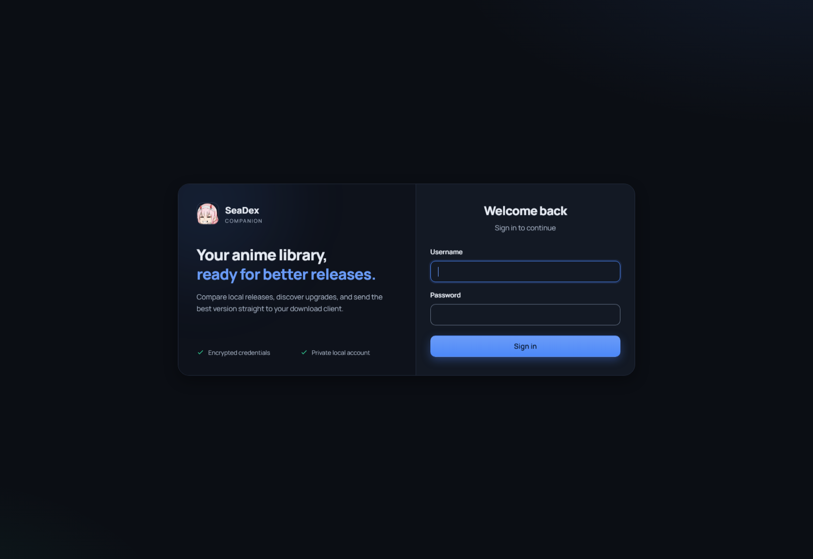

# SeaDex Companion

SeaDex Companion compares your **Sonarr** and **Radarr** anime libraries with the best releases indexed by [SeaDex](https://seadex.moe/). See which titles need an upgrade, review your current releases season by season, and send selected public releases directly to qBittorrent.

<p align="center">
  
</p>

> [!WARNING]
> This project is built and maintained as a personal, heavily AI-assisted project. It is tested with care, but you should review its configuration and behavior before relying on it.

## Highlights

- See all seasons of an anime together, with clear upgrade and ownership summaries.
- Compare your current release groups, episode coverage, and file sizes with SeaDex recommendations.
- Find titles by name, release group, source, or upgrade status.
- Correct AniList matches and exclude individual seasons or cours from upgrades.
- Download individual releases or review a batch, with size estimates and available-disk-space checks.
- Monitor downloads, pause or resume torrents, and cancel downloads while preserving files by default.
- Track unseen release changes and receive optional Discord notifications.
- Schedule scans or connect Sonarr and Radarr webhooks to scan newly added titles.
- Use a password-protected interface on desktop or mobile, with encrypted storage for integration credentials.

## Quick start

### Docker

The published image is available from [Docker Hub](https://hub.docker.com/r/hiranaka/seadex-companion) for Linux amd64 and arm64. You need a Sonarr or Radarr library that SeaDex Companion can reach; qBittorrent is optional unless you want to download releases.

```bash
docker run -d \
  --name seadex-companion \
  --restart unless-stopped \
  -p 127.0.0.1:8080:8080 \
  -v seadex-data:/app/data \
  hiranaka/seadex-companion:latest
```

Open [http://localhost:8080](http://localhost:8080), create the administrator account, then configure your services under **Configuration**.

Keep the `seadex-data` volume: it stores your settings, account, integration credentials, matching corrections, and scan history. Both installation examples limit access to the host computer. See [Security](#security) before setting up access from other devices.

### Docker Compose

To use Compose, create a `compose.yaml` file with the following settings:

```yaml
services:
  seadex-companion:
    image: hiranaka/seadex-companion:latest
    container_name: seadex-companion
    ports:
      - "127.0.0.1:8080:8080"
    volumes:
      - seadex-data:/app/data
    environment:
      - PORT=8080
      - DATA_DIR=/app/data
      - TZ=Europe/Berlin
    restart: unless-stopped

volumes:
  seadex-data:
```

Replace `TZ` with your timezone, such as `Europe/Berlin` or `America/New_York`. Start SeaDex Companion from the folder containing your `compose.yaml`:

```bash
docker compose up -d
```

Open [http://localhost:8080](http://localhost:8080) and create your administrator account. The `latest` image follows stable releases; use a specific version tag if you prefer to choose when to upgrade.

## Connect your library

All integrations are configured in the WebUI; no integration credentials need to be passed through Docker.

1. Use the connection checklist to add and test a Sonarr URL and API key or a Radarr URL and API key. Use **Show all settings** to configure both.
2. Add qBittorrent credentials to enable downloads.
3. Optionally add a Discord webhook for upgrade notifications.
4. Test each configured integration, save, and select **Scan library**.
5. Configure automatic scans under **Configuration → Automation & webhooks**.

Use addresses reachable from the SeaDex Companion container. Inside a container, `localhost` refers to that container, so it usually cannot reach Sonarr or qBittorrent running elsewhere through `localhost`.

Sonarr v3, v4, and v5 are supported. Enter each service's base URL, including any reverse-proxy path, such as `http://sonarr:8989/sonarr`. If your proxy redirects to a different address or from HTTP to HTTPS, enter the final URL directly.

## Review your library

Open **Details** on an anime to see its quality verdict, the release groups in your files, and the recommended upgrades. Expand a season or cour to compare releases and download options. A cour is one part of a split season.

**Not on SeaDex** means there is no matching SeaDex listing. **Match needs review** means SeaDex Companion needs help identifying the correct anime or season. A matching release group alone does not mean a season is complete; review any missing-episode or uncertain-coverage messages as well.

### Correct a season match

If Sonarr groups seasons differently from AniList, open the anime's details and use the match control beside the affected season. Select its AniList entry, then **Save and rescan**. For split cours, select each entry in episode order; use **Move up** to change their order.

Season corrections affect only that season. Choose **Use automatic match** to remove a correction. Your matching corrections and exclusions survive clearing scanned data.

### Download and monitor upgrades

Download an individual release from **Details**, or open bulk review to select several upgrades. Bulk review includes titles matching your current filters across all pages. Choose **Entire library** to include titles outside those filters; hidden titles start unchecked.

Review the release groups, selected episodes, download sizes, and available disk space before submitting. Torrents already present in qBittorrent are skipped. When filenames identify the required episodes, SeaDex Companion can download only the selected files; otherwise, review the whole-torrent scope before proceeding.

Disk-space checks may be unavailable for some download paths or older qBittorrent versions. Size estimates do not reserve space or include torrent overhead and library-import copies. Run a new scan if older results are missing file-size information.

Choose **Continue in background** to keep using the app while a batch runs. Closing the page does not cancel downloads. **Review batch** reopens your latest submitted review in the same session, and download progress is recovered after a reload. After a SeaDex Companion restart, check qBittorrent before retrying downloads reported as interrupted.

Use the download controls to pause, resume, cancel, or remove torrents. File deletion is optional; downloaded files are preserved by default.

## Automatic scans and notifications

Set an interval, daily times, or weekdays under **Configuration → Automation & webhooks**. Choose the timezone and what should happen if a scan was missed while SeaDex Companion was offline.

**Unhide anime with new best releases** is off by default. Enable it to bring hidden titles back when a scan finds a new best release. Alternative releases do not trigger this setting. Add a Discord webhook under **Configuration** if you want upgrade notifications.

To scan newly added titles sooner, add these webhook connections in Sonarr and Radarr using HTTP Basic Authentication with your SeaDex Companion username and password:

- Sonarr: `https://your-seadex-host/api/webhooks/sonarr`
- Radarr: `https://your-seadex-host/api/webhooks/radarr`

Enable Sonarr `SeriesAdd` or Radarr `MovieAdded` events for the corresponding connection. Keep a scheduled scan enabled as well to check existing titles for changed SeaDex recommendations.

## Reviewing release changes

The library's **Unseen changes** filter shows anime with release changes you have not reviewed, including new best releases, alternatives, updated torrents or metadata, and removals. Its count covers matching titles across all pages, with the latest changes first. Cards label the affected seasons; open **Details → What changed** for the before/after summary and detection time. Use **Mark reviewed** for one anime, or **Mark all reviewed** for all titles matching the current library filters. Opening the app or completing another unchanged scan does not clear these changes.

Reviewed changes stay reviewed across reloads and devices. A first scan or newly discovered title starts without unseen alerts. New changes appear after a completed scan; they are not live notifications of upstream publication.

## Updating and backups

Back up the complete `seadex-data` volume before upgrading or moving to another host. Keep the encryption key and the rest of the data together so your saved integration credentials remain usable. Keep a pre-upgrade backup if you may need to return to an older version.

For the Compose setup above, update with:

```bash
docker compose pull
docker compose up -d
```

For `docker run`, pull the new image, stop and remove the old container, then run the installation command again with the same `seadex-data` volume:

```bash
docker pull hiranaka/seadex-companion:latest
docker stop seadex-companion
docker rm seadex-companion
```

New images take effect after the container is recreated. See the [release notes](https://github.com/hiranaka99/SeaDex-Companion/releases) for changes and any additional upgrade steps.

## Security

> [!IMPORTANT]
> SeaDex Companion is intended for a trusted home network. Do not expose port `8080` directly to the internet.

For remote access, prefer a private VPN. If you use a reverse proxy, require HTTPS and access controls, and forward `X-Forwarded-Proto: https` so session cookies are marked `Secure`.

- Use a unique administrator password.
- Keep the container and host patched.
- Do not grant untrusted users administrator access; configured integration URLs can reach private services on the application's network.
- Back up the persistent `seadex-data` volume before upgrades or host migration.

## Support and license

- Report defects through [GitHub Issues](https://github.com/hiranaka99/SeaDex-Companion/issues).
- Licensed under the [MIT License](LICENSE).

## Screenshots

### Release details



### Bulk download review



### Bulk cancellation



### Scan history



### Sign in


